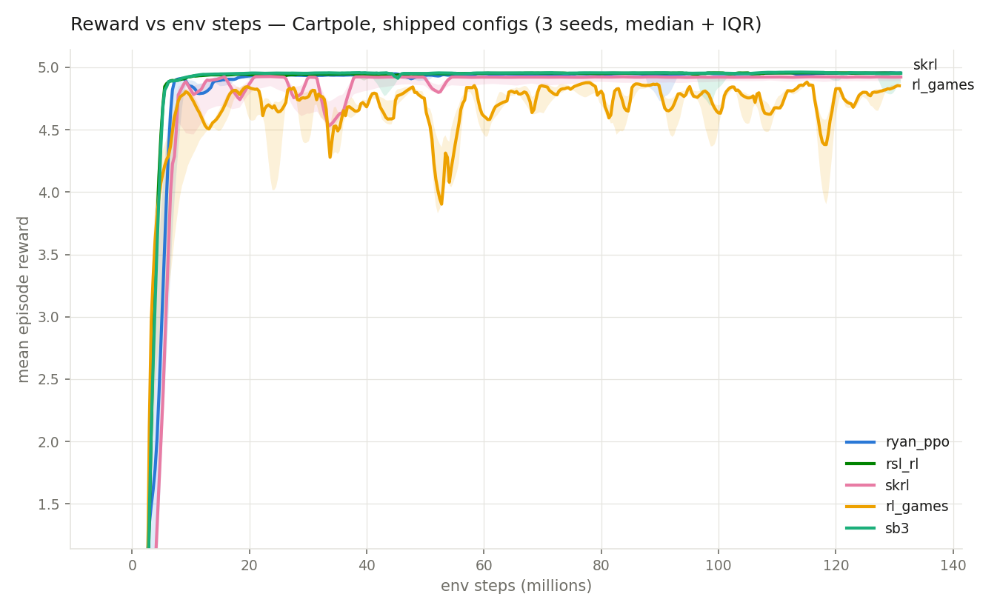
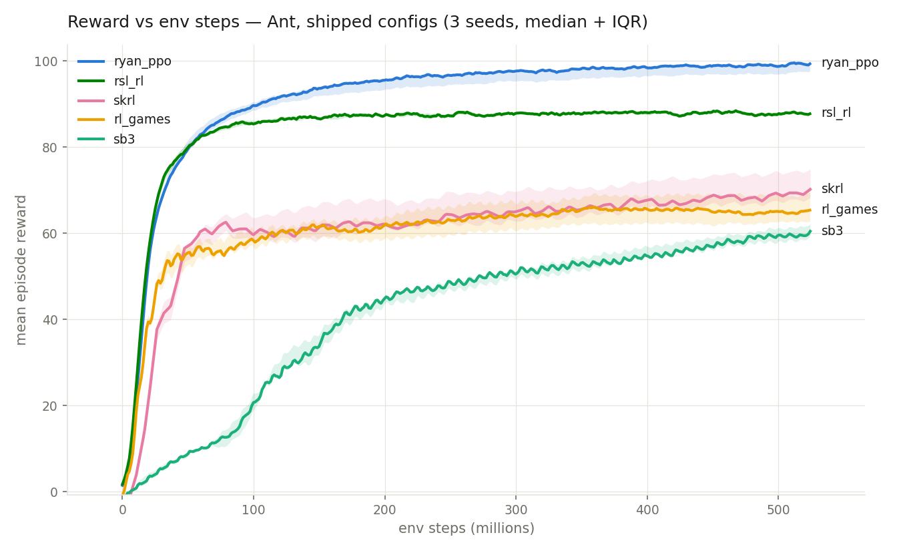
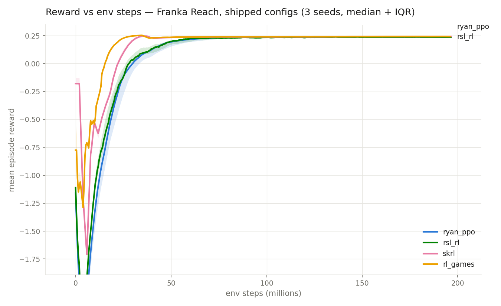

# Benchmark results

## Throughput

I benchmarked this implementation against the four RL libraries bundled with Isaac Lab — [rsl_rl](https://github.com/leggedrobotics/rsl_rl), [rl_games](https://github.com/Denys88/rl_games), [skrl](https://github.com/Toni-SM/skrl), and [sb3](https://github.com/DLR-RM/stable-baselines3) on three tasks, cartpole, ant, and my SO-ARM101 reach task. Every run used 8,192 parallel environments on an RTX 5080, headless, and each library's agent config matched. This is a throughput speed measurement, however my library has a slightly longer startup due to pytorch compilation of some functions. In a short run like cartpole, this could affect the total time more significantly than longer runs. I think with the speedup that they provide, especially for more complex tasks that require long runs, the benefits outweigh this penalty.

**Cartpole** — 16 steps/env

| Framework | Throughput (steps/s) | Iteration (ms) | Update (ms) | Peak VRAM (MiB) | ryan_ppo speedup |
|---|---:|---:|---:|---:|---:|
| **ryan_ppo (this repo)** | **1,946,720** | **67** | **4** | 3,878 | — |
| skrl | 1,113,700 | 118 | 41 | 3,554 | 1.75× |
| rl_games | 1,094,944 | 120 | 40 | 3,574 | 1.78× |
| rsl_rl | 1,069,663 | 123 | 45 | 3,556 | 1.82× |
| sb3 | 662,625 | 198 | — | 3,546 | 2.94× |

**Ant** — 32 steps/env

| Framework | Throughput (steps/s) | Iteration (ms) | Update (ms) | Peak VRAM (MiB) | ryan_ppo speedup |
|---|---:|---:|---:|---:|---:|
| **ryan_ppo (this repo)** | **999,627** | **262** | **27** | 5,126 | — |
| skrl | 887,326 | 295 | 57 | 4,628 | 1.13× |
| rl_games | 855,095 | 307 | 55 | 4,648 | 1.17× |
| rsl_rl | 813,526 | 322 | 62 | 4,618 | 1.23× |
| sb3 | 480,713 | 545 | — | 4,468 | 2.08× |

**Reach** — 24 steps/env

| Framework | Throughput (steps/s) | Iteration (ms) | Update (ms) | Peak VRAM (MiB) | ryan_ppo speedup |
|---|---:|---:|---:|---:|---:|
| **ryan_ppo (this repo)** | **2,042,640** | **96** | **11** | 4,602 | — |
| skrl | 805,616 | 244 | 151 | 4,178 | 2.54× |
| rl_games | 763,976 | 257 | 157 | 4,186 | 2.67× |
| rsl_rl | 558,209 | 352 | 186 | 4,184 | 3.66× |
| sb3 | 490,714 | 401 | — | 3,970 | 4.16× |

`ryan_ppo` has the highest throughput on every task: 1.13–2.54× the next-fastest library and 2.08–4.16× sb3. For every task, the execution time for the physics is largely unchanged library to library, and the library implementation controls the interface of the agent with the physics, and the update steps of the PPO algorithm. My library has a significantly faster update portion, and some of the surrounding framework for the rollouts is also optimized better.

## Faster environments

Each of the three tasks also has a direct workflow version running on Newton (MuJoCo Warp) physics with a CUDA-graph-captured physics step, instead of going through Isaac Lab's managers on PhysX. In these tasks, both the usage of a direct workflow instead of a manager based workflow, and the usage of the Newton physics backend instead of the PhysX backend improve the throughput of the task on the environment side. Same benchmark:

**Cartpole (direct, Newton)** — 16 steps/env

| Framework | Throughput (steps/s) | Iteration (ms) | Update (ms) | Peak VRAM (MiB) | ryan_ppo speedup |
|---|---:|---:|---:|---:|---:|
| **ryan_ppo (this repo)** | **4,003,560** | **33** | **4** | 834 | — |
| skrl | 1,751,637 | 75 | 35 | 534 | 2.29× |
| rl_games | 1,716,817 | 76 | 34 | 552 | 2.33× |
| rsl_rl | 1,687,069 | 78 | 38 | 534 | 2.37× |
| sb3 | 902,636 | 145 | — | 526 | 4.44× |

**Ant (direct, Newton)** — 32 steps/env

| Framework | Throughput (steps/s) | Iteration (ms) | Update (ms) | Peak VRAM (MiB) | ryan_ppo speedup |
|---|---:|---:|---:|---:|---:|
| **ryan_ppo (this repo)** | **2,036,439** | **129** | **27** | 2,098 | — |
| rl_games | 1,548,980 | 169 | 50 | 1,386 | 1.31× |
| skrl | 1,547,217 | 169 | 54 | 1,364 | 1.32× |
| rsl_rl | 1,372,037 | 191 | 59 | 1,358 | 1.48× |
| sb3 | 652,823 | 402 | — | 1,206 | 3.12× |

**Reach (direct, Newton)** — 24 steps/env

| Framework | Throughput (steps/s) | Iteration (ms) | Update (ms) | Peak VRAM (MiB) | ryan_ppo speedup |
|---|---:|---:|---:|---:|---:|
| **ryan_ppo (this repo)** | **2,426,587** | **81** | **11** | 1,508 | — |
| skrl | 1,005,592 | 196 | 124 | 1,134 | 2.41× |
| rl_games | 943,847 | 208 | 134 | 1,138 | 2.57× |
| sb3 | 576,920 | 341 | — | 1,052 | 4.21× |
| rsl_rl | 473,407 | 415 | 150 | 1,136 | 5.13× |

## Steel physics

[Steel](https://github.com/newton-physics/newton) is a new open-source physics engine from Skild AI. It is integrated into the main branch of newton, and will be integrated in Isaac Lab soon. They have large claims of up to 13x faster and 3x less memory usage compared to PhysX simulation. I wanted to test this out since I am very interested in fast simulators. Results from my tests are shown below on the same setup as I use for the standard Newton and PhysX.

**Cartpole (Steel)** — 16 steps/env

| Framework | Throughput (steps/s) | Iteration (ms) | Update (ms) | Peak VRAM (MiB) | ryan_ppo speedup |
|---|---:|---:|---:|---:|---:|
| **ryan_ppo (this repo)** | **3,803,023** | **34** | **4** | 822 | — |
| skrl | 1,677,103 | 78 | 35 | 500 | 2.27× |
| rsl_rl | 1,637,661 | 80 | 38 | 500 | 2.32× |
| rl_games | 1,615,584 | 81 | 36 | 518 | 2.35× |
| sb3 | 874,491 | 150 | — | 492 | 4.35× |

**Ant (Steel)** — 32 steps/env

| Framework | Throughput (steps/s) | Iteration (ms) | Update (ms) | Peak VRAM (MiB) | ryan_ppo speedup |
|---|---:|---:|---:|---:|---:|
| **ryan_ppo (this repo)** | **2,390,414** | **110** | **27** | 1,828 | — |
| rl_games | 1,687,209 | 155 | 50 | 1,316 | 1.42× |
| skrl | 1,679,534 | 156 | 55 | 1,294 | 1.42× |
| rsl_rl | 1,303,442 | 201 | 59 | 1,284 | 1.83× |
| sb3 | 631,211 | 415 | — | 1,136 | 3.79× |

**Reach (Steel)** — 24 steps/env

| Framework | Throughput (steps/s) | Iteration (ms) | Update (ms) | Peak VRAM (MiB) | ryan_ppo speedup |
|---|---:|---:|---:|---:|---:|
| **ryan_ppo (this repo)** | **2,710,204** | **73** | **11** | 1,266 | — |
| skrl | 971,766 | 202 | 127 | 806 | 2.79× |
| rl_games | 930,310 | 211 | 136 | 814 | 2.91× |
| rsl_rl | 707,047 | 278 | 148 | 808 | 3.83× |
| sb3 | 572,045 | 344 | — | 724 | 4.74× |

## Direct workflow w/ Steel physics

**Cartpole (direct, Steel)** — 16 steps/env

| Framework | Throughput (steps/s) | Iteration (ms) | Update (ms) | Peak VRAM (MiB) | ryan_ppo speedup |
|---|---:|---:|---:|---:|---:|
| **ryan_ppo (this repo)** | **4,659,909** | **28** | **4** | 798 | — |
| skrl | 1,821,141 | 72 | 36 | 500 | 2.56× |
| rsl_rl | 1,788,708 | 73 | 38 | 498 | 2.61× |
| rl_games | 1,781,958 | 74 | 36 | 516 | 2.62× |
| sb3 | 904,485 | 145 | — | 490 | 5.15× |

**Ant (direct, Steel)** — 32 steps/env

| Framework | Throughput (steps/s) | Iteration (ms) | Update (ms) | Peak VRAM (MiB) | ryan_ppo speedup |
|---|---:|---:|---:|---:|---:|
| **ryan_ppo (this repo)** | **2,782,213** | **94** | **27** | 2,026 | — |
| rl_games | 1,901,471 | 138 | 50 | 1,316 | 1.46× |
| skrl | 1,896,535 | 138 | 55 | 1,294 | 1.47× |
| rsl_rl | 1,478,435 | 177 | 58 | 1,286 | 1.88× |
| sb3 | 657,210 | 399 | — | 1,136 | 4.23× |

**Reach (direct, Steel)** — 24 steps/env

| Framework | Throughput (steps/s) | Iteration (ms) | Update (ms) | Peak VRAM (MiB) | ryan_ppo speedup |
|---|---:|---:|---:|---:|---:|
| **ryan_ppo (this repo)** | **3,324,592** | **59** | **11** | 1,282 | — |
| skrl | 1,047,599 | 188 | 128 | 908 | 3.17× |
| rl_games | 1,019,757 | 193 | 133 | 914 | 3.26× |
| rsl_rl | 735,132 | 267 | 151 | 910 | 4.52× |
| sb3 | 598,857 | 328 | — | 824 | 5.55× |

## Learning

The above sections focus on how the training throughput of my library compares to the other libraries, measured with short runs that don't learn a full policy. This is only relevant if my library also learns the tasks as well as them. To measure this, I also ran a number of runs to verify the learned behavior is on par or better than the other libraries. I did this with three tasks, Cartpole, Ant, and Franka Reach. Each library performs a training run on the tasks, one for each of three set seeds (42, 43, 44), using the config that is provided with Isaac Lab by that library for each task. These were all run on an RTX 5080, with 8192 parallel envs. Some adjustments had to be made for rl_games and sb3, to scale from the default 4096 envs to 8192 envs. The rewards are the median across the three seeds, and the "final" rewards value is the mean of the last 10% of the training run. Range is 25th-75th percentile.

**Cartpole** — 131M env steps (1,000 iterations)

| Framework | Final reward | Seed range | Throughput (steps/s) | Wall-clock (min) |
|---|---:|---:|---:|---:|
| **ryan_ppo (this repo)** | **4.954** | 4.951–4.954 | **1,820,493** | **1.5** |
| rsl_rl | 4.953 | 4.940–4.954 | 1,172,452 | 2.1 |
| sb3 | 4.953 | 4.951–4.956 | 193,833 | 11.5 |
| skrl | 4.922 | 4.888–4.927 | 837,575 | 2.9 |
| rl_games | 4.797 | 4.782–4.801 | 784,086 | 3.0 |

  

**Ant** — 524M env steps (2,000 iterations at 32 steps/env; 4,000 for the libraries that ship 16 steps/env)

| Framework | Final reward | Seed range | Throughput (steps/s) | Wall-clock (min) |
|---|---:|---:|---:|---:|
| **ryan_ppo (this repo)** | **99.0** | 97.1–99.2 | **990,794** | **9.3** |
| rsl_rl | 87.6 | 87.5–88.0 | 667,776 | 13.5 |
| skrl | 68.9 | 67.3–74.0 | 877,204 | 10.4 |
| rl_games | 64.7 | 62.5–68.9 | 861,793 | 10.6 |
| sb3 | 59.3 | 58.0–61.1 | 561,684 | 16.0 |

  

**Franka Reach** — 197M env steps (1,000 iterations)

| Framework | Final reward | Seed range | Throughput (steps/s) | Wall-clock (min) |
|---|---:|---:|---:|---:|
| **ryan_ppo (this repo)** | 0.240 | 0.239–0.240 | **503,474** | **7.2** |
| rl_games | **0.243** | 0.243–0.243 | 452,301 | 7.9 |
| skrl | 0.242 | 0.242–0.243 | 449,226 | 7.9 |
| rsl_rl | 0.237 | 0.236–0.237 | 441,120 | 8.1 |

  

Peak VRAM (MiB) with these configs, measured on separate 100-iteration runs:

| Framework | Cartpole | Ant | Franka Reach |
|---|---:|---:|---:|
| **ryan_ppo (this repo)** | 3,846 | 5,090 | 4,628 |
| rsl_rl | 3,554 | 5,068 | 4,224 |
| skrl | 3,532 | 4,544 | 4,284 |
| rl_games | 3,528 | 4,386 | 4,286 |
| sb3 | 3,510 | 4,522 | — |

In the Ant task, my library clearly outperforms the others in this small benchmark, in both learning and speed. For the other two tasks, all the libraries learn similar policies, however mine finishes training first. For these tasks, my library appears to have some sample inefficiency early on compared to the others, so it doesn't necessarily reach every reward threshold before the others. The takeaway I had from this is that my library is able to accurately learn tasks comparatively to the shipped libraries, while having a significantly higher training throughput due to the effort spent on optimizing portions of the loop.